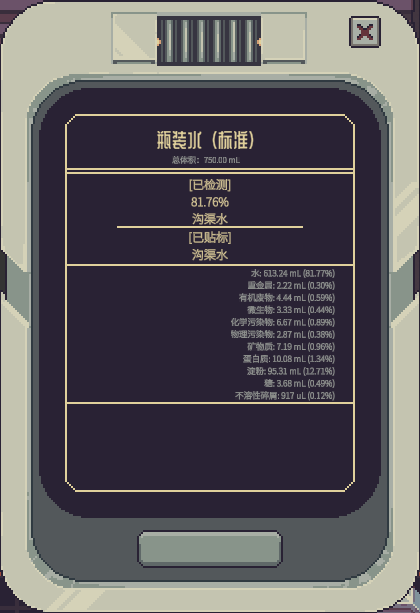
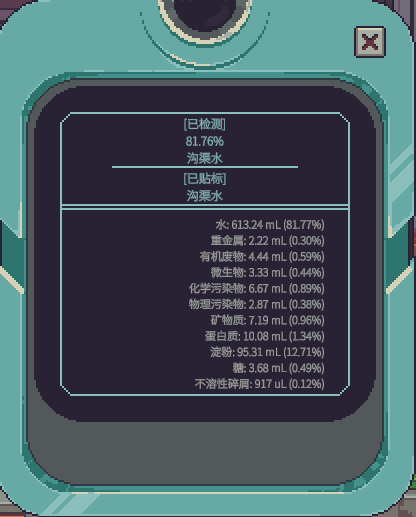
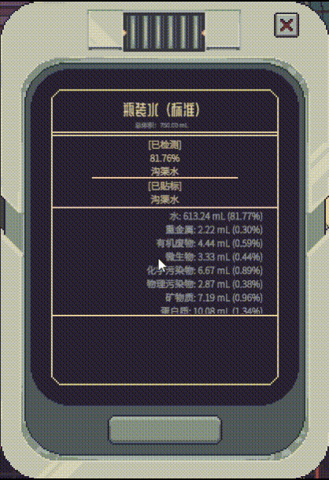
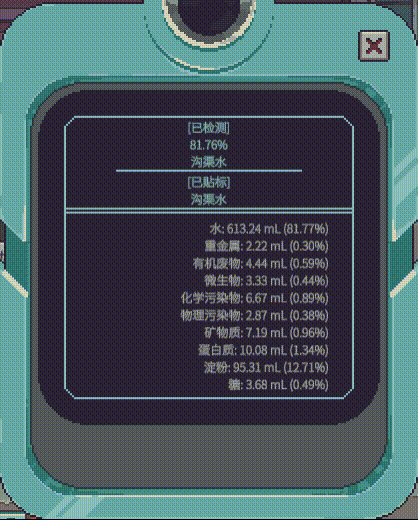

# Save My Eyes

[中文](#中文) | [English](#English)

## 中文

成分光谱仪和水质扫描仪的界面显示内容的字体会自动缩小，内容一多就会难以看清。

Mod 取消了这个行为，字体会维持原始大小，并让区域可滚动显示。

### 安装

去右侧的 Release 界面下载 zip 后把整个 `SaveMyEyes` 文件夹解压到游戏的 `Mods` 目录：

```
Probably Stolen/Mods/SaveMyEyes/
├─ SaveMyEyes.dll
└─ manifest.xml
```

就应该只有 **2 个文件**

然后在游戏的 Mod 面板里启用它，重启游戏。

尚未明确游戏官方关于如何上传 Mod 到 Steam 创意工坊的步骤，我拒绝 SteamCMD 古法上传。

### 功能截图对比

前：





后：





### 项目构建

**1. 定位游戏路径**

在与 csproj 同级目录下新建 `Directory.Build.props`，改这两个路径：

```xml
<Project>
  <PropertyGroup>
    <GamePath>X:/Steam/steamapps/common/Probably Stolen</GamePath>
    <ModsPath>X:/Steam/steamapps/common/Probably Stolen/Mods</ModsPath>
  </PropertyGroup>
</Project>
```

**2. 编译**

可以命令行：

```
dotnet build
```

也可以直接在你的 IDE 里操作

DLL 和 `manifest.xml` 会直接输出到 `Mods/SaveMyEyes`。

然后在游戏的 Mod 面板里启用它，重启游戏。

## English

Not yet (ask AI plz..)
